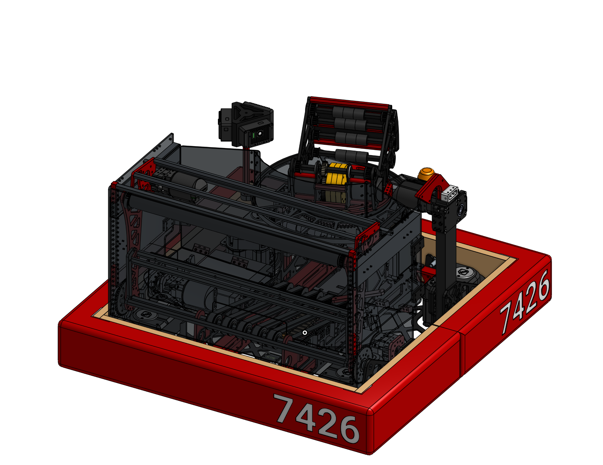
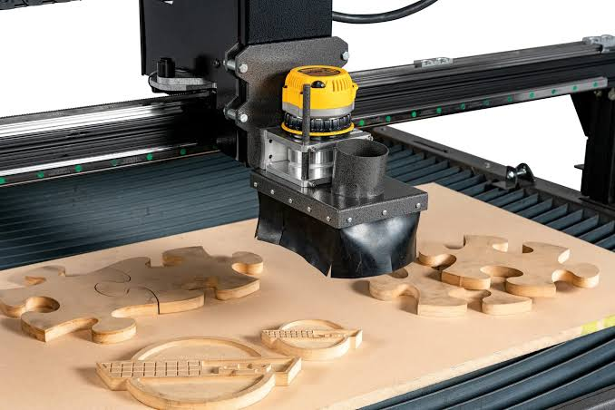
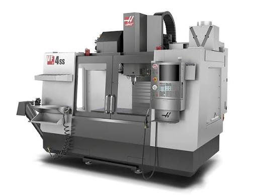
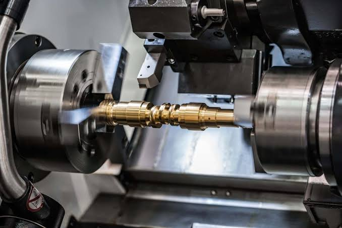
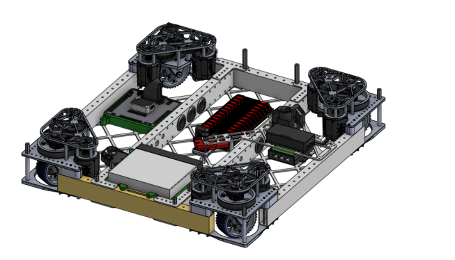

# Design Philosophy

Pair of Dice Design: EVERYTHING

# Synopsis

I want to put this onto a site but writing everything down before I can get a site up and running is much more efficient for now! This will go over in mostly two parts one is mostly the more barebones of such of FRC Design BUT this is not FRCDesign.org but something that covers more on the side that FRCDesign does not cover. For example, they really don’t emphasize WHY we use some certain features. In this, I will include some mathematical and physical explanations in such a way that will just provide context and provide some contextual information that may also help for intuitive understanding of design and therefore create “smart” designs due to better understanding of designs.

So what makes a design “good?”

A good design is subjective, but what seems to be applicable to all teams is that a good design is a design that gamers might be familiar with this term “META” (Most Effective Tactic Available). Take it as is, make something that you can make but is also efficient at the game.

To make it more specific to FRC, I’d probably make it more like (note that i really wanted to use the term meta so if you can come up with more creative acronyms let me know)

M: Manufacturable

E: Efficient

T: Thoughtful

A: Adaptable

Now let me explain each term

## Manufacturable:

If you can’t manufacture it, you won’t have a robot duh.  That may sound easier said than done but it is true. If you have something that is hard to manufacture then, your robot is sadly a fantasy. However knowing what you have is going to let you know what your limitations are. Here’s just a simple run-through of every tool that you’d probably see.

The most common designs in robotics are the plate and the tube (2 dimensional surfaces only!!), which are usually routed. It’s important to understand how routing works and the limitations of your router, talk to your machinist about your limitations and such!

There are also objects with more three dimensional surfaces, this will commonly be milled, and similarly to the router, talk to your machinist about the limitations of and such, just know that the more axis you have on the mill, the more possibilities that can occur

The same applies to the lathe but with cylindrical shaped objects/objects that can be held together easily by a chuck

# Efficiency:

In my personal opinion, I believe that efficiency is subjective and that every team will have an efficient design that fits them the best. An example of this will include that a team with limited access to a machine may not want to include weight reduction onto their robot because they need less runtime on the router. But from what I see from most teams, it seems to a common trend to focus on:

Power efficiency

Does the nature of the design make the motors work harder than they have to?

Could it possible to reduce the load the motors bear

Weight

FRC has a weight limit, however this does not mean to always make your robot as lightweight as possible, Championship 2025 winning team 2910 used brass on their robot as a counter weight to prevent imbalances from their arm

Gets the most from the game

This sounds really self explanatory and obvious but there's a catch, while you should aim for a bot to score a lot, think about areas in the game that may be overlooked. Remember that FRC is a sport that requires strategy, not just a pure robot power test

EXAMPLE: Team 971's 2018 robot sacrificed some potential for pure scoring performance by dedicating substantial design complexity to its climbing and partner-assist capabilities. This made the robot more valuable to an alliance because it could contribute to the endgame and potentially enable a second robot to climb, rather than being optimized solely for scoring Power Cubes.

# Thoughtful:

You must remember that you are a team, everywhere you go, you must remember that this is a robotics team and one of the biggest things from FIRST is that teamwork is the way for success. There will be someone making the robot, there will be someone needing to access ports, wires, and etc. And as the designer, you have control whether or not to sacrifice accessibility for a design that will allow for more efficiency. This is something that MUST be discussed with your team and a consensus must occur between assembly and design. Remember, the best design is the one that suits your team.

## Adaptable:

Accidents happen, A LOT. Your robot will go through multiple rounds of defense, driving, practice, and wear. You have to prepare for damages to occur. You must consider how important a part would be if something were to happen to it. For example, if a brittle part were to break, would it be impossible to play after? What would happen if something were to get stuck on it? Could you replace the part easily? You must design with caution and consideration of what could happen to your robot.